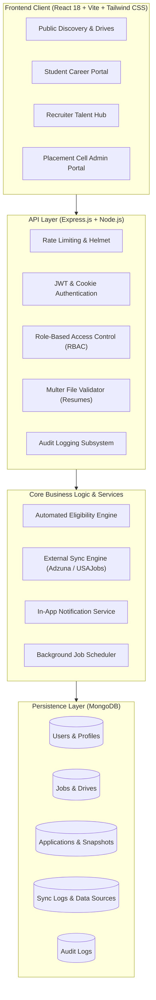
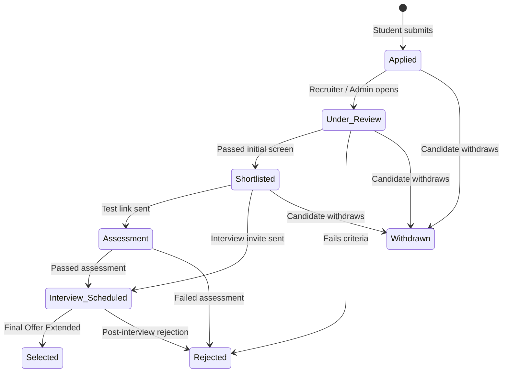

# PlacementOS — System Architecture & Design Specification

## 1. System Overview

**PlacementOS** is an enterprise-grade full-stack web platform built to automate and coordinate the complete campus placement and internship lifecycle. It bridges the gap between graduating engineering students, verified enterprise recruiters, and college placement leadership.

---

## 2. Layered Responsibilities

### 2.1 Presentation Layer (Frontend)
- **Framework**: React 18, React Router v6, Tailwind CSS with customized dark navy/electric indigo theme.
- **Data Visualization**: Recharts for interactive hiring funnels, application status distributions, and demand skills.
- **Feedback**: React Hot Toast for non-intrusive transactional feedback.
- **Client Architecture**: Modular feature pages separated by stakeholder role (`student/`, `recruiter/`, `admin/`, `jobs/`, `drives/`, `companies/`).

### 2.2 API & Middleware Layer (Backend)
- **RESTful Endpoints**: Predictable resource-oriented URLs returning structured JSON envelopes (`{ success: true, data: ... }`).
- **Authentication**: Stateless JSON Web Tokens (JWT) verified via Bearer header or HTTP cookies.
- **Security Middlewares**:
  - `helmet`: Secure HTTP headers (CSP, frameguard, XSS protection).
  - `express-rate-limit`: Brute-force throttling on `/api/auth/*` endpoints.
  - `uploadMiddleware`: Validates file signatures, restricting uploads to valid PDF/DOCX resumes under 5MB.
  - Centralized error handler catching Mongoose validation errors, duplicate keys, and cast errors.

### 2.3 Business Logic & Service Engines

#### A. Automated Eligibility Engine (`eligibilityService.js`)
When an application is submitted or a listing is viewed by an authenticated student, this service validates:
1. **CGPA Threshold**: `student.cgpa >= job.eligibility.minCgpa`
2. **Discipline / Branch Alignment**: Evaluates whether `job.eligibility.allowedBranches` contains student branch.
3. **Graduation Batch**: Verifies `job.eligibility.allowedGraduationYears`.
4. **Active Backlogs**: Verifies `student.backlogs <= job.eligibility.maxBacklogs`.
5. **Deadline Constraints**: Validates against `job.applicationDeadline`.

#### B. Immutable Snapshot Engine
When a student applies, PlacementOS captures immutable snapshots:
- `profileSnapshot`: Degree, branch, CGPA, backlogs, skills, phone, and resume URL at the instant of application.
- `eligibilitySnapshot`: Status and reasons evaluated at submission time.
- **Guarantee**: Future edits to student profile never mutate historical recruitment decisions.

#### C. Real-World Data Pipeline & Deduplication (`syncService.js`)
- Adapter-based architecture with `BaseAdapter` interface.
- Implementations for **Adzuna Jobs API** and **USAJobs Open Data API**.
- Deduplication: Uses unique `(sourceProvider, externalId)` compound index. Existing listings update timestamps and compensation; new listings are created.
- Transparent Configuration Reporting: Never fakes data. When credentials are absent, accurately marks provider as `not_configured` and maintains historical sync logs.

---

## 3. Application Lifecycle State Machine

