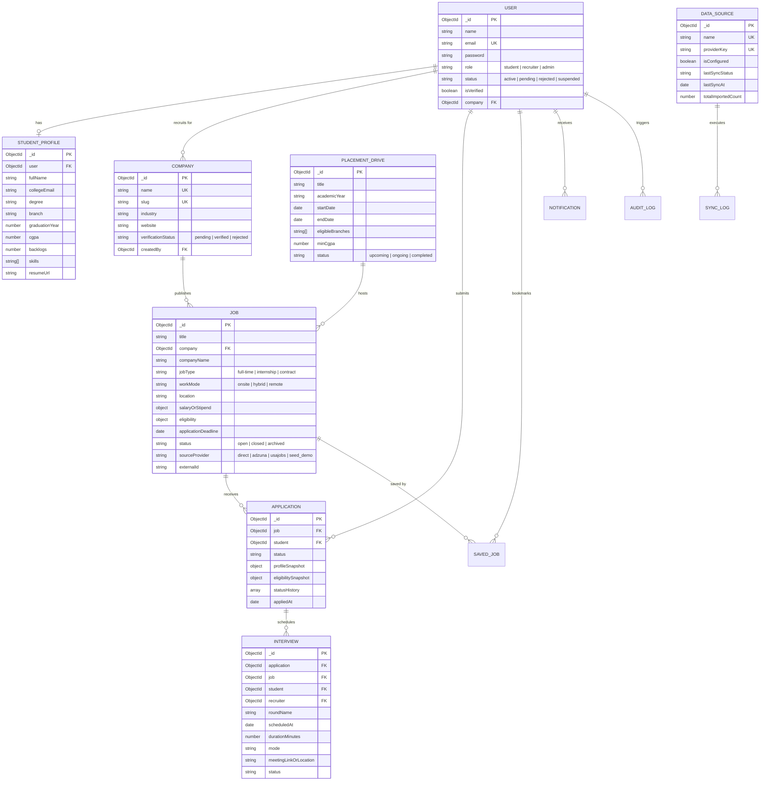

# PlacementOS — Database Architecture & Schema Specification

## 1. Entity-Relationship Diagram

---

## 2. Collection Specifications

### 2.1 Users (`users`)
| Field | Type | Attributes | Description |
|---|---|---|---|
| `_id` | ObjectId | Primary Key | Unique document identifier |
| `name` | String | Required, Trim | Full user name |
| `email` | String | Required, Unique, Lowercase | Primary contact and login credential |
| `password` | String | Required, Select: false | Bcrypt hashed password (salt cost 10) |
| `role` | String | Enum: `student`, `recruiter`, `admin` | System role for RBAC permissions |
| `status` | String | Enum: `active`, `pending`, `rejected`, `suspended` | Recruiter approval & account status |
| `isVerified` | Boolean | Default: based on role | Verified credentials status |
| `company` | ObjectId | Ref: `Company`, Nullable | Linked employer for recruiter role |

### 2.2 StudentProfiles (`studentprofiles`)
| Field | Type | Attributes | Description |
|---|---|---|---|
| `_id` | ObjectId | Primary Key | Unique identifier |
| `user` | ObjectId | Ref: `User`, Unique | 1-to-1 linkage to User account |
| `fullName` | String | Required | Official student name |
| `collegeEmail` | String | Lowercase | Official college email address |
| `university` | String | Default: College Name | Enrolled college |
| `degree` | String | e.g. `B.Tech` | Degree program |
| `branch` | String | e.g. `Computer Science & Engineering` | Academic department |
| `graduationYear` | Number | Indexed | Year of graduation |
| `cgpa` | Number | Min 0, Max 10 | Current recorded cumulative GPA |
| `backlogs` | Number | Min 0, Default: 0 | Number of active uncleared backlogs |
| `skills` | [String] | Array | Technical competencies |
| `projects` | [ProjectSubdoc] | Subdocument array | Portfolio software engineering projects |
| `resumeUrl` | String | Path/URL | Server path to uploaded PDF/DOCX resume |

### 2.3 Companies (`companies`)
| Field | Type | Attributes | Description |
|---|---|---|---|
| `_id` | ObjectId | Primary Key | Unique identifier |
| `name` | String | Required, Unique | Official registered corporate name |
| `slug` | String | Unique, Indexed | SEO URL friendly slug |
| `verificationStatus` | String | Enum: `pending`, `verified`, `rejected` | Admin verification status |
| `industry` | String | Default: `Technology` | Industry classification |
| `size` | String | Enum: `1-10`, `51-200`, `1000+`, etc. | Employee headcount bracket |

### 2.4 Jobs (`jobs`)
| Field | Type | Attributes | Description |
|---|---|---|---|
| `_id` | ObjectId | Primary Key | Unique identifier |
| `title` | String | Required, Text Indexed | Opportunity role title |
| `company` | ObjectId | Ref: `Company`, Nullable | Nullable for external API synced feeds |
| `companyName` | String | Required, Indexed | Name of hiring company |
| `jobType` | String | Enum: `full-time`, `internship`, `contract` | Placement type |
| `workMode` | String | Enum: `onsite`, `hybrid`, `remote` | Office arrangement |
| `location` | String | Required | Work location |
| `salaryOrStipend` | Object | `{ min, max, currency, period, isDisclosed }` | Compensation structure |
| `eligibility` | Object | `{ minCgpa, allowedBranches, allowedGraduationYears, maxBacklogs }` | Automated criteria rules |
| `applicationDeadline`| Date | Required, Indexed | Closing timestamp |
| `sourceProvider` | String | Enum: `direct`, `adzuna`, `usajobs`, `seed_demo` | Integration provenance |
| `externalId` | String | Sparse Indexed | External API listing identifier |

### 2.5 Applications (`applications`)
| Field | Type | Attributes | Description |
|---|---|---|---|
| `_id` | ObjectId | Primary Key | Unique identifier |
| `job` | ObjectId | Ref: `Job`, Required | Opportunity reference |
| `student` | ObjectId | Ref: `User`, Required | Student applicant reference |
| `status` | String | Enum: `applied`, `under_review`, `shortlisted`, `assessment`, `interview_scheduled`, `selected`, `rejected`, `withdrawn` | Recruitment state |
| `profileSnapshot` | Object | Immutable snapshot | Academic records at time of submission |
| `eligibilitySnapshot`| Object | `{ isEligible, reasons, evaluatedAt }` | Evaluated eligibility decisions |
| `statusHistory` | Array | `[{ status, changedBy, note, changedAt }]` | Step-by-step audit progression |

**Compound Unique Index**:
- `{ job: 1, student: 1 }` with `{ unique: true }` strictly enforces that a candidate cannot submit duplicate applications to the same opportunity.

### 2.6 SavedJobs (`savedjobs`)
| Field | Type | Attributes | Description |
|---|---|---|---|
| `_id` | ObjectId | Primary Key | Unique identifier |
| `student` | ObjectId | Ref: `User`, Required | Student who wishlisted |
| `job` | ObjectId | Ref: `Job`, Required | Bookmarked job |
| `savedAt` | Date | Default: `Date.now` | Bookmark timestamp |

**Compound Unique Index**:
- `{ student: 1, job: 1 }` with `{ unique: true }`.

### 2.7 PlacementDrives (`placementdrives`)
| Field | Type | Attributes | Description |
|---|---|---|---|
| `_id` | ObjectId | Primary Key | Unique identifier |
| `title` | String | Required | Recruitment drive title |
| `academicYear` | String | e.g. `2025-2026` | Academic cohort |
| `startDate` | Date | Required | Drive launch date |
| `endDate` | Date | Required | Drive closing date |
| `minCgpa` | Number | Default: `6.5` | Drive-wide minimum CGPA cutoff |
| `maxBacklogs` | Number | Default: `0` | Drive-wide maximum backlogs |
| `status` | String | Enum: `upcoming`, `ongoing`, `completed`, `archived` | Operating status |

### 2.8 DataSources (`datasources`)
| Field | Type | Attributes | Description |
|---|---|---|---|
| `_id` | ObjectId | Primary Key | Unique identifier |
| `name` | String | Unique | Source display title |
| `providerKey` | String | Unique, Enum: `adzuna`, `usajobs` | Adapter identifier |
| `isConfigured` | Boolean | Dynamic | Whether credentials exist in environment |
| `lastSyncStatus` | String | Enum: `idle`, `success`, `failed`, `partial`, `not_configured` | Health state |
| `totalImportedCount`| Number | Default: 0 | Total listings synchronized |

### 2.9 SyncLogs (`synclogs`)
| Field | Type | Attributes | Description |
|---|---|---|---|
| `_id` | ObjectId | Primary Key | Unique identifier |
| `providerKey` | String | Indexed | Integration provider |
| `status` | String | Enum: `success`, `partial`, `failed`, `not_configured` | Job outcome |
| `itemsFetched` | Number | Number of raw results received |
| `itemsImported`| Number | New unique listings added |
| `itemsUpdated` | Number | Existing listings refreshed |
| `executionDurationMs` | Number | Duration in milliseconds |
| `timestamp` | Date | Indexed | Timestamp of execution |

### 2.10 AuditLogs (`auditlogs`)
| Field | Type | Attributes | Description |
|---|---|---|---|
| `_id` | ObjectId | Primary Key | Unique identifier |
| `user` | ObjectId | Ref: `User`, Nullable | Actor user |
| `userEmail` | String | Default: `anonymous` | Actor email |
| `role` | String | Actor role |
| `action` | String | Required, Indexed | Transaction verb (e.g. `UPDATE_APPLICATION_STATUS`) |
| `resourceType` | String | Required | Target entity name |
| `ipAddress` | String | Client IP |
| `timestamp` | Date | Indexed | Event timestamp |
